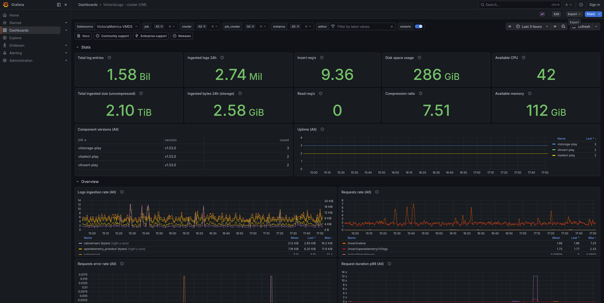
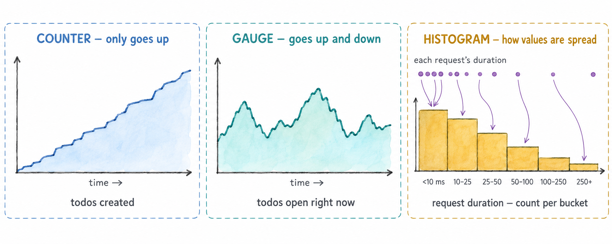

# Módulo 1: Observabilidad y OpenTelemetry

Antes de tocar código, este módulo explica qué significa observabilidad, los tres tipos de
datos en los que se apoya — métricas, logs y trazas — y qué es OpenTelemetry, para que el
resto del taller se apoye en un vocabulario compartido. 🧠

## Objetivos de Aprendizaje

Al terminar este módulo, serás capaz de:

- Saber qué es la observabilidad, qué es la telemetría y en qué se diferencia la observabilidad de la monitorización
- Saber qué es una métrica, un registro de log y una traza
- Saber qué es OpenTelemetry, qué aporta y qué no
- Saber dónde se guarda cada señal en este taller

## 1.1 — Qué es la observabilidad

La **observabilidad** es poder entender qué está haciendo un sistema, y por qué, a partir
de los datos que emite — sin tener que cambiar su código ni desplegar una versión nueva cada
vez que te surge una pregunta nueva.

Esos datos se llaman **telemetría**: medidas y registros que una aplicación produce sobre
su propio comportamiento mientras funciona. Cuántas peticiones está sirviendo, cuánto
tardan, cuáles fallan, qué pasó dentro de cada una.

Un sistema es observable cuando su telemetría te permite responder preguntas como estas:

- ¿Funciona ahora mismo? ¿Les están llegando errores a los usuarios, o esperan más de lo
  normal?
- Cuando algo va mal, ¿dónde? ¿En qué servicio, en qué endpoint, a qué usuarios?
- ¿Por qué? ¿Qué tenían de distinto las peticiones que fallaron?

En la práctica es así: la aplicación emite telemetría, un backend la guarda y una
herramienta como Grafana te permite consultarla y verla.

### Monitorización y observabilidad

Las dos palabras suelen aparecer juntas, y están relacionadas, pero no significan lo
mismo.

La **monitorización** consiste en vigilar problemas que ya conoces. Decides de antemano qué
importa — la tasa de errores, la latencia, el disco que se llena —, construyes un dashboard
para ello, como el de abajo, y pones una alerta que salta cuando un valor cruza un umbral.
Responde a la pregunta *¿algo va mal?*, para los fallos que pudiste prever.



La **observabilidad** es poder investigar problemas que no previste. Cuando salta una
alerta, o un usuario cuenta algo que ningún dashboard muestra, necesitas hacer preguntas
nuevas — *¿qué peticiones van lentas? ¿qué tienen en común? ¿dónde se va el tiempo?* — y
sacar las respuestas de la telemetría que ya tienes, sin desplegar código nuevo antes.

Para eso, lo que cuenta es toda la telemetría en bruto que emite el sistema, no una
selección ya dibujada en un dashboard. Esto, por ejemplo, es un fragmento de las métricas
que expone un único programa en Go: cientos de series sobre su memoria y su recolector de
basura. Nadie las pone todas en un dashboard, pero están ahí para el día en que una pregunta
las necesite.

```
# HELP go_gc_cycles_total_gc_cycles_total Count of all completed GC cycles.
# TYPE go_gc_cycles_total_gc_cycles_total counter
go_gc_cycles_total_gc_cycles_total 4178
# HELP go_gc_duration_seconds A summary of the wall-time pause (stop-the-world) duration in garbage collection cycles.
# TYPE go_gc_duration_seconds summary
go_gc_duration_seconds{quantile="0"} 4.264e-05
go_gc_duration_seconds{quantile="0.25"} 5.74e-05
go_gc_duration_seconds{quantile="0.5"} 7.328e-05
go_gc_duration_seconds{quantile="0.75"} 9.705e-05
go_gc_duration_seconds{quantile="1"} 0.00033989
go_gc_duration_seconds_sum 0.58628048
go_gc_duration_seconds_count 4178
# HELP go_gc_gogc_percent Heap size target percentage configured by the user, otherwise 100.
# TYPE go_gc_gogc_percent gauge
go_gc_gogc_percent 100
# HELP go_gc_heap_allocs_by_size_bytes Distribution of heap allocations by approximate size.
# TYPE go_gc_heap_allocs_by_size_bytes histogram
go_gc_heap_allocs_by_size_bytes_bucket{le="8.999999999999998"} 1.504735e+07
go_gc_heap_allocs_by_size_bytes_bucket{le="24.999999999999996"} 5.11605082e+08
go_gc_heap_allocs_by_size_bytes_bucket{le="64.99999999999999"} 6.88034454e+08
go_gc_heap_allocs_by_size_bytes_bucket{le="144.99999999999997"} 7.36567619e+08
go_gc_heap_allocs_by_size_bytes_bucket{le="320.99999999999994"} 8.13562355e+08
go_gc_heap_allocs_by_size_bytes_bucket{le="+Inf"} 8.37473303e+08
go_gc_heap_allocs_by_size_bytes_sum 1.82533046496e+11
go_gc_heap_allocs_by_size_bytes_count 8.37473303e+08
...
```

| | Monitorización | Observabilidad |
|---|---|---|
| Preguntas | Conocidas de antemano | Surgen durante una investigación |
| Respuestas | *¿Algo va mal?* | *¿Dónde, y por qué?* |
| Herramientas típicas | Dashboards y alertas | Consultas que filtran, agrupan y siguen una petición concreta |

La monitorización se construye sobre la misma telemetría. Un sistema observable se puede
monitorizar, y la alerta suele ser el punto de partida de una investigación.

La telemetría es de tres tipos, llamados **señales**: métricas, logs y trazas. Las tres
secciones siguientes explican cada una.

## 1.2 — Métricas

Una **métrica** es un número medido a lo largo del tiempo. En vez de registrar cada evento,
la aplicación mantiene valores agregados — una cuenta, una suma, una distribución — y los
exporta periódicamente, por defecto cada 60 segundos (cada 10 en este taller).

Esta es una métrica, un counter de los todos creados, separada en sus partes:


Cada combinación de nombre de métrica y valores de sus labels es una **serie temporal**
distinta: el mismo counter con `list="home"` en vez de `list="work"` es otra serie, con su
propio valor. El número de series temporales distintas es lo que llamamos
**cardinalidad**, y por ahora basta con saber que es importante mantenerla baja.

### Tipos de métrica

La métrica de arriba es un **counter**. Hay varios tipos de métrica, y los tres que más vas
a usar son:

| Tipo | Qué registra | Ejemplo |
|---|---|---|
| **Counter** | Un total que solo sube | todos creados |
| **Gauge** | Un valor en un momento dado, que sube y baja | todos abiertos ahora mismo |
| **Histogram** | La distribución de los valores medidos | duración de las peticiones |



Un histogram no guarda cada valor que mide. Cuenta cuántos cayeron en cada rango, llamado
**bucket**: cuántas peticiones tardaron menos de 10 ms, cuántas entre 10 y 25 ms, y así
sucesivamente. Con eso basta para responder preguntas como *¿cuánto tardó el 5% más lento
de las peticiones?* sin guardar cada petición.

## 1.3 — Logs

Un **registro de log** describe un evento que ocurrió en un momento concreto: una petición
falló, se creó un todo, se reintentó una conexión. A diferencia de una métrica, cada evento
produce su propio registro. Un registro de log tiene un cuerpo (el
mensaje), una severidad, una marca de tiempo y atributos, y si se emitió mientras se
atendía una petición, los identificadores de la traza de esa petición.


El contexto es lo que hace útil una línea de log más allá de leerla: cada par `clave=valor`
es un campo por el que puedes filtrar y agrupar.

## 1.4 — Trazas

Una **traza** sigue una petición a través del sistema. Está formada por **spans**: cada
span es una operación con un momento de inicio, una duración y atributos — atender una
petición HTTP, ejecutar una consulta a la base de datos, llamar a otro servicio. Los spans
tienen padres, así que juntos forman un árbol que muestra qué pasó, en qué orden y cuánto
tardó cada paso. Cuando una petición pasa de un servicio a otro, el trace id viaja con ella
en una cabecera HTTP (`traceparent`), así que los spans de los dos servicios acaban en la
misma traza.


## 1.5 — Qué es OpenTelemetry

**OpenTelemetry** (OTel, para abreviar) es un proyecto de código abierto, parte de la Cloud
Native Computing Foundation, que estandariza cómo las aplicaciones producen telemetría y
cómo se envía a algún sitio. Aporta:

- **Una API y un SDK para cada lenguaje** — JavaScript, Python, Java, Go, .NET y muchos
  más — para crear telemetría desde tu código.
- **Librerías de instrumentación** que producen telemetría para frameworks y librerías
  habituales (servidores HTTP, drivers de base de datos, clientes HTTP) sin que tengas que
  escribir ese código.
- **Convenciones semánticas**: nombres acordados para las cosas comunes — `service.name`,
  `http.route`, `http.response.status_code` — para que la telemetría de lenguajes y
  librerías distintos tenga la misma forma.
- **OTLP**, el protocolo de OpenTelemetry, para enviar telemetría de un componente a otro.
- **El Collector**, un programa que recibe telemetría, la procesa y la reenvía.

OpenTelemetry **no** guarda ni muestra la telemetría. Eso es trabajo de un backend — en
este taller VictoriaMetrics, VictoriaLogs y VictoriaTraces — y de una herramienta como
Grafana. Como el formato y el protocolo son estándar, instrumentas tu aplicación una vez y
puedes enviar su telemetría a cualquier backend compatible sin cambiar el código.

Cubre las tres señales — métricas, logs y trazas — con la misma API, el mismo protocolo y
el mismo Collector.

## 1.6 — Dónde va cada señal en este taller

Tu aplicación envía las tres señales al OpenTelemetry Collector, que reenvía cada una a su
propio almacenamiento:

| Señal | Se guarda en | Se consulta con |
|---|---|---|
| Métricas | VictoriaMetrics | MetricsQL (compatible con PromQL) |
| Logs | VictoriaLogs | LogsQL |
| Trazas | VictoriaTraces | LogsQL |

Los logs y las trazas comparten el mismo lenguaje de consulta.
