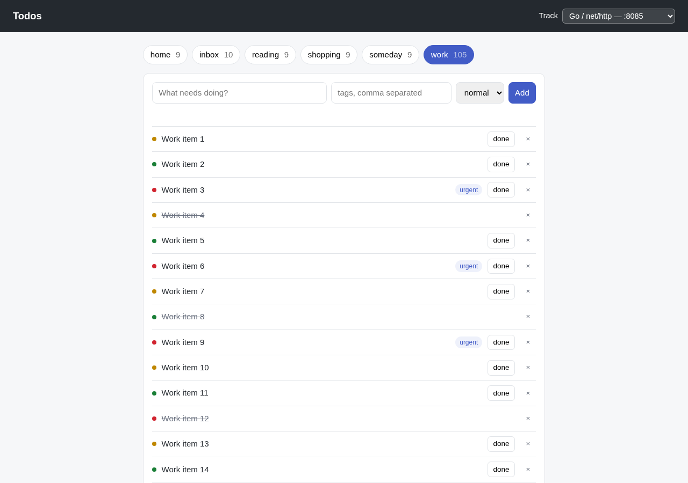

# Módulo 3: La Aplicación que Vas a Instrumentar

No puedes instrumentar un sistema que no entiendes. Este módulo es un recorrido guiado por la app de tareas: qué piezas tiene, qué hace la API y dónde vive su código. 🗺️

## Objetivos de Aprendizaje

Al terminar este módulo, serás capaz de:

- Dibujar el sistema de memoria: qué servicio llama a cuál, y por dónde
- Enumerar todos los endpoints que expone la API y qué toca cada uno
- Conocer los cuatro ficheros de tu track que vas a editar todo el día, y qué vive en cada uno

## La aplicación en tu navegador

Abre [http://localhost:8080](http://localhost:8080) para ver la app de tareas funcionando en tu portátil. El selector de track de la esquina superior derecha elige a qué API llama el frontend. Puedes cambiar de lista, añadir una tarea con etiquetas y prioridad, marcarla como completada o borrarla.



## El sistema


Cuatro cosas que merece la pena notar:

1. **`todo-api` es lo único que editas.** Corre en un contenedor `node:22-slim` o
   `python:3.12-slim` de serie, con el directorio de código de tu portátil montado dentro
   y el servidor en modo vigilancia — así tu editor edita ficheros de verdad, y guardar uno
   es todo el ciclo de construir y desplegar. Todo lo demás es decorado fijo.
2. **Postgres es su única dependencia externa.** La caché que hay delante del camino de
   lectura es un map en memoria, no Redis: nada en la red puede observarla.
3. **`notify-service` es el mismo en todos los tracks.** Es un pequeño servicio en Python
   en `:8083`, ya instrumentado, al que tu API llama para enviar notificaciones. Nunca lo
   editas; está ahí para que una petición pueda viajar de un servicio a otro, y para que
   puedas seguirla.
4. **`./loadgen.sh` mantiene el tráfico**, así siempre hay algo que mirar. Ejecuta
   `./loadgen.sh 2m` cuando las gráficas se queden quietas.

## La API

| Método | Ruta | Qué hace | Toca |
|---|---|---|---|
| `GET` | `/healthz` | Sonda de vida | nada |
| `GET` | `/lists` | Todas las listas con sus contadores | Postgres |
| `GET` | `/todos?list=<nombre>` | Todos de una lista | Postgres, caché |
| `GET` | `/todos/:id` | Un todo | Postgres |
| `POST` | `/todos` | Crea un todo | Postgres, caché, `notify-service` (solo los urgentes) |
| `PATCH` | `/todos/:id/complete` | Marca un todo como completado | Postgres, caché |
| `DELETE` | `/todos/:id` | Borra un todo | Postgres, caché |
| `GET` | `/stats` | Contadores resumen para el dashboard | Postgres, `notify-service` |

Un todo tiene esta pinta:

```json
{
  "id": "0f2c6b1e-8a7d-4f2b-9c31-0a5e6d7b8c90",
  "title": "Renovar el certificado TLS",
  "list": "work",
  "slug": "R-renovar-el-certificado-t",
  "tags": ["urgent", "infra"],
  "priority": 2,
  "due_at": "2026-09-05T09:00:00Z",
  "created_at": "2026-09-01T08:12:44Z",
  "completed_at": null
}
```

Dos comportamientos conviene saberlos desde ya, porque condicionan la telemetría:

- **Un todo con la etiqueta `urgent` dispara una llamada a `notify-service`** al crearse. Los que no la llevan, no.
- **Las lecturas de listas pasan primero por la caché en proceso**, y van a Postgres cuando no encuentran el dato en la caché.

## El código

<!-- track:js -->

```
track-js/todo-api/
├── package.json
└── src/
    ├── server.js         # app express, middleware, rutas, arranque
    ├── routes/todos.js   # ◀ los handlers — es lo que más vas a editar
    ├── repo.js           # ◀ todo el acceso a Postgres
    ├── cache.js          # ◀ la caché en proceso
    ├── notify.js         # ◀ el cliente de notify-service
    ├── enrich.js         # lógica de negocio de etiquetas y prioridad
    ├── log.js            # el logger pino
    └── db.js             # el pool de conexiones a Postgres
```

Los cuatro ficheros marcados con ◀ son donde ocurre prácticamente todo tu trabajo.

**`src/server.js`** — Express pelado, sin sorpresas, mostrado aquí sin los detalles de CORS y de manejo de errores. Fíjate en que no hay configuración de telemetría por ninguna parte. Ese es el punto de partida. La línea de `SIGTERM` está para que el servidor salga enseguida cuando guardas un fichero y se reinicia:

```js
require('express-async-errors');
const express = require('express');
const { todosRouter } = require('./routes/todos.js');
const { waitForDependencies } = require('./db.js');
const { log } = require('./log.js');

const app = express();
const port = Number(process.env.PORT ?? 8081);

app.use(express.json());
// … cabeceras CORS, para que el frontend pueda llamar a la API desde el navegador

app.get('/healthz', (_req, res) => res.json({ ok: true }));
app.use(todosRouter);
// … un manejador de errores que registra el fallo y responde 500

process.on('SIGTERM', () => setTimeout(() => process.exit(0), 500));

waitForDependencies().then(() => {
  app.listen(port, () => log.info(`todo-api listening on ${port}`));
});
```

**`src/routes/todos.js`** — los handlers:

```js
todosRouter.post('/todos', async (req, res) => {
  const todo = await createTodo(req.body);          // repo.js
  const enriched = await enrich(todo);              // enrich.js
  await setSlug(todo.id, enriched.slug);            // repo.js

  if (todo.tags.includes('urgent')) {
    await notifyUrgent(enriched);                   // notify.js → :8083
  }

  invalidate(todo.list);                            // cache.js
  log.info('todo created ' + todo.id);              // log.js
  res.status(201).json(enriched);
});

todosRouter.patch('/todos/:id/complete', async (req, res) => {
  const todo = await completeTodo(req.params.id);   // repo.js
  if (!todo) return res.status(404).json({ error: 'not found or already complete' });
  invalidate(todo.list);                            // cache.js
  log.info('todo completed ' + todo.id);            // log.js
  res.json(todo);
});
```

<!-- /track -->

<!-- track:python -->

```
track-py/todo-api/
├── requirements.txt
├── app.py                # factoría flask, blueprints, arranque
└── todo_api/
    ├── routes.py         # ◀ los handlers — es lo que más vas a editar
    ├── repo.py           # ◀ todo el acceso a Postgres
    ├── cache.py          # ◀ la caché en proceso
    ├── notify.py         # ◀ el cliente de notify-service
    ├── enrich.py         # lógica de negocio de etiquetas y prioridad
    ├── log.py            # el logger de la stdlib
    └── db.py             # el pool de conexiones a Postgres
```

Los cuatro ficheros marcados con ◀ son donde ocurre prácticamente todo tu trabajo.

**`app.py`** — Flask pelado, sin sorpresas, mostrado aquí sin los detalles de CORS. Fíjate en que no hay configuración de telemetría por ninguna parte. Ese es el punto de partida:

```python
from flask import Flask, jsonify

from todo_api.db import wait_for_dependencies
from todo_api.routes import bp


def create_app() -> Flask:
    app = Flask(__name__)
    app.register_blueprint(bp)

    @app.get("/healthz")
    def healthz():
        return jsonify(ok=True)

    # … cabeceras CORS, para que el frontend pueda llamar a la API desde el navegador

    return app


wait_for_dependencies()
app = create_app()
```

**`todo_api/routes.py`** — los handlers:

```python
@bp.post("/todos")
def post_todo():
    todo = create_todo(request.get_json(silent=True))  # repo.py
    enriched = enrich(todo)                            # enrich.py
    set_slug(todo.id, enriched["slug"])                # repo.py

    if "urgent" in todo.tags:
        notify_urgent(enriched)                        # notify.py → :8083

    invalidate(todo.list)                              # cache.py
    log.info("todo created %s", todo.id)               # log.py
    return jsonify(enriched), 201


@bp.patch("/todos/<todo_id>/complete")
def patch_complete(todo_id):
    todo = complete_todo(todo_id)                      # repo.py
    if todo is None:
        return jsonify(error="not found or already complete"), 404
    invalidate(todo.list)                              # cache.py
    log.info("todo completed %s", todo.id)             # log.py
    return jsonify(todo.to_dict())
```

<!-- /track -->

<!-- track:go -->

```
track-go/todo-api/
├── go.mod
├── main.go           # servidor net/http, middleware, rutas, arranque
├── routes.go         # ◀ los handlers de las peticiones — el que más vas a editar
├── repo.go           # ◀ todo el acceso a Postgres
├── cache.go          # ◀ la caché en proceso
├── notify.go         # ◀ el cliente de notify-service
├── enrich.go         # lógica de negocio de etiquetas y prioridad
├── log.go            # el logger slog
└── db.go             # el pool de conexiones a Postgres
```

Los cuatro ficheros marcados con ◀ son donde ocurre prácticamente todo tu trabajo.

**`main.go`** — el `net/http` de la librería estándar, sin framework, mostrado aquí sin los detalles de CORS. Fíjate en que no hay configuración de telemetría por ninguna parte. Ese es el punto de partida. Cada handler devuelve un `error`; el pequeño tipo `handler` lo registra y responde 500, como haría el manejador de errores de un framework web:

```go
func main() {
	if err := waitForDependencies(); err != nil {
		log.Error("startup failed: " + err.Error())
		os.Exit(1)
	}

	port := envString("PORT", "8085")

	mux := http.NewServeMux()
	mux.HandleFunc("GET /healthz", func(w http.ResponseWriter, _ *http.Request) {
		writeJSON(w, http.StatusOK, map[string]bool{"ok": true})
	})
	routes(mux)

	log.Info("todo-api listening on " + port)
	// cors() añade cabeceras CORS, para que el frontend pueda llamar a la API desde el navegador
	if err := http.ListenAndServe(":"+port, cors(mux)); err != nil {
		log.Error("server stopped: " + err.Error())
		os.Exit(1)
	}
}

// handler es un http.HandlerFunc que puede fallar.
type handler func(w http.ResponseWriter, r *http.Request) error

func (h handler) ServeHTTP(w http.ResponseWriter, r *http.Request) {
	if err := h(w, r); err != nil {
		log.Error("request failed: " + err.Error())
		writeJSON(w, http.StatusInternalServerError, map[string]string{"error": "internal"})
	}
}
```

**`routes.go`** — los handlers:

```go
func postTodo(w http.ResponseWriter, r *http.Request) error {
	ctx := r.Context()
	body, _ := io.ReadAll(r.Body)

	todo, err := createTodo(ctx, body)                // repo.go
	if err != nil {
		return err
	}
	enriched, err := enrich(todo)                     // enrich.go
	if err != nil {
		return err
	}
	if err := setSlug(ctx, todo.ID, *enriched.Slug); err != nil {   // repo.go
		return err
	}

	if slices.Contains(todo.Tags, "urgent") {
		if _, err := notifyUrgent(ctx, enriched); err != nil {     // notify.go → :8083
			return err
		}
	}

	invalidate(todo.List)                             // cache.go
	log.Info("todo created " + todo.ID)               // log.go
	return writeJSON(w, http.StatusCreated, enriched)
}

func patchComplete(w http.ResponseWriter, r *http.Request) error {
	todo, err := completeTodo(r.Context(), r.PathValue("id"))   // repo.go
	if err != nil {
		return err
	}
	if todo == nil {
		return writeJSON(w, http.StatusNotFound, map[string]string{"error": "not found or already complete"})
	}
	invalidate(todo.List)                             // cache.go
	log.Info("todo completed " + todo.ID)             // log.go
	return writeJSON(w, http.StatusOK, todo)
}
```

<!-- /track -->
