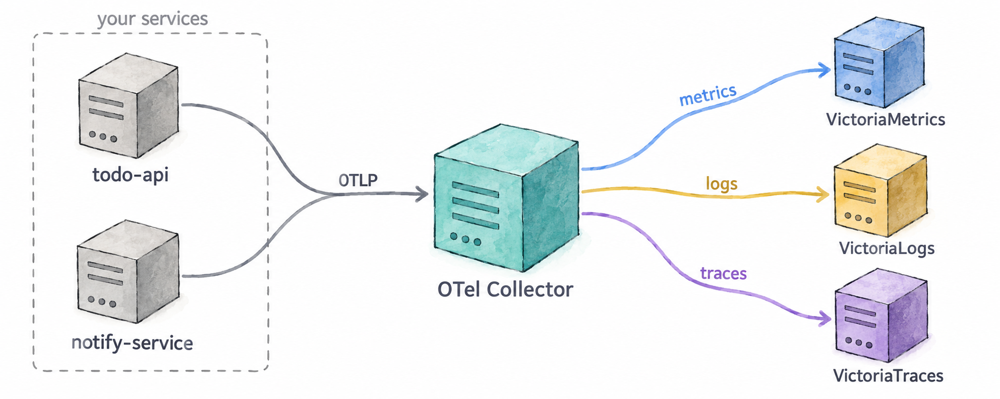

# Module 5: The OpenTelemetry Collector

In Module 4 your application started sending all three signals to a single address,
`otel-collector:4318`, and they ended up in three different backends. This module is about
what sits at that address: what the OpenTelemetry Collector is, what it can do, and what
the one in this workshop is already doing to your telemetry. 📦

## Learning Objectives

By the end of this module, you will:

- Know what the OpenTelemetry Collector is and where it sits between your application and
  your backends
- Know its building blocks — receivers, processors, exporters, connectors and pipelines
- Know the kinds of problems it solves
- Be able to say what this workshop's Collector does to your metrics, logs and traces

## 5.1 — What the Collector is

The **OpenTelemetry Collector** is a standalone program, part of the OpenTelemetry
project, that receives telemetry, processes it and sends it on. It is vendor-neutral: it
speaks OTLP, the OpenTelemetry protocol, and dozens of other formats, in and out.

Your application doesn't need it — an SDK can export straight to a backend. But putting a
Collector in the middle changes who has to know what:

- **Your application knows one endpoint.** It sends everything over OTLP to the Collector
  and is done. It doesn't know which backends exist, where they are, or what each one
  expects.
- **The Collector knows everything else.** Which backend gets which signal, at what URL,
  with which headers, and what to change on the way. Change a backend, add a second one,
  or start dropping something noisy, and no application has to be redeployed.

## 5.2 — The building blocks

A Collector is configured from a handful of component types:

| Component | What it does | Examples |
|---|---|---|
| **Receivers** | Get telemetry in — by listening for it or by fetching it | OTLP, Prometheus scraping, log files, Kafka |
| **Processors** | Change telemetry on the way through | batch, filter, add or remove attributes, sampling, redaction |
| **Exporters** | Send telemetry out | OTLP to any compatible backend, Prometheus remote write, Kafka, files |
| **Connectors** | Join two pipelines: an exporter on one and a receiver on the other | turn spans into metrics, route by attribute |
| **Extensions** | Things that aren't about the data itself | health checks, authentication |

Components are wired together into **pipelines**, one per signal. A pipeline says: take
the metrics (or logs, or traces) from these receivers, run them through these processors
in this order, and hand them to these exporters. A component that is declared but not used
in any pipeline does nothing.

## 5.3 — What it can do

Most of what makes a Collector worth running falls into a few groups:

- **Routing.** Send each signal to the backend that stores it, or the same signal to two
  backends at once — useful during a migration.
- **Enrichment.** Add attributes the application doesn't know about: the environment, the
  cluster, the region.
- **Normalisation.** Make telemetry from different SDKs, languages and versions look the
  same before it is stored, so queries and dashboards only deal with one shape.
- **Reduction.** Drop what you don't need — health-check spans, debug logs, an attribute
  nobody queries — before you pay to store it. Sample traces, keeping the interesting ones.
- **Protection.** Remove sensitive data, such as emails or tokens, in one place instead of
  in every application.
- **Derivation.** Produce new telemetry from existing telemetry, such as request rate,
  errors and duration computed from spans.
- **Reliability.** Batch telemetry for efficiency, retry when a backend is down, queue
  while it recovers, and refuse work rather than run out of memory.
- **Translation.** Accept telemetry in one format and send it in another — scrape
  Prometheus endpoints, read log files, receive Jaeger or Zipkin.

It is commonly deployed in two ways, often both at once: as an **agent** next to each
application, on the same host or in the same pod, and as a **gateway**, a central pool
that agents and applications send to.

## 5.4 — What this workshop's Collector does

The Collector you have been sending to since Module 4 is configured in
`collector/config.yaml`. You don't need to read or change it; this is what it does.

**Receivers**
- **OTLP**, on port 4318 (HTTP) and 4317 (gRPC). This is where `todo-api` and
  `notify-service` send their metrics, logs and traces.
- **Its own metrics.** The Collector reports on itself — what it received, what it sent,
  how full its queues are — and scrapes those numbers into its own metrics pipeline, so
  they land in VictoriaMetrics like any other metric. The **Telemetry pipeline** row of
  the Auto-Instrumentation dashboard in Grafana is built from them.

**Processors**, applied in this order:
- **`memory_limiter`** — makes the Collector refuse data when it is close to its memory
  limit, instead of crashing and losing everything.
- **`resource`** — adds `deployment.environment=workshop` to all telemetry, so every
  metric, log and span says which environment it came from, even if an application forgot
  to set it.
- **`transform/severity`** — logs only. The JavaScript SDK reports levels in lower case
  (`info`) and the Python SDK in upper case (`INFO`). This processor converts them all to
  upper case, so a query for `ERROR` finds errors from both languages.
- **`batch`** — groups telemetry into larger requests before sending it, which is far
  cheaper for both the Collector and the backends.

**Exporters**, one per backend:
- **VictoriaMetrics** receives the metrics.
- **VictoriaLogs** receives the logs, with a `VL-Stream-Fields` header that tells
  VictoriaLogs how to group them into streams: by `service.name` and
  `deployment.environment`.
- **VictoriaTraces** receives the traces.

**Extensions**
- **`health_check`**, on port 13133. It answers whether the Collector is up; `doctor.sh`
  uses it.

And the pipelines that connect them:

| Signal | Receivers | Processors | Exporter |
|---|---|---|---|
| Metrics | OTLP, its own metrics | `memory_limiter`, `resource`, `batch` | VictoriaMetrics |
| Logs | OTLP | `memory_limiter`, `resource`, `transform/severity`, `batch` | VictoriaLogs |
| Traces | OTLP | `memory_limiter`, `resource`, `batch` | VictoriaTraces |
